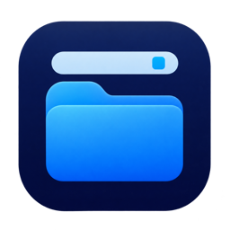

# 폴더인바 (Folder In Bar)



메뉴 막대에서 선택한 폴더의 파일을 목록이나 아이콘 격자로 확인하고, 한 번 클릭해 기본 앱으로 여는 macOS 앱입니다. 전체 화면에서도 메뉴 막대를 표시해 사용할 수 있습니다.

앱 이름은 **폴더인바(Folder In Bar)**, 소스 저장소는 **mindw96/DesktopButton**입니다. 현재 공개 버전은 **0.4.0 (build 6)**입니다. 빌드·UI 검증 결과와 공증·배포 진행 상태는 [VALIDATION.md](VALIDATION.md)에 기록합니다.

기존 OneButton의 폴더 연결과 앱 설정을 이어서 사용할 수 있습니다. 배포 앱과 실행 파일의 이름은 `Folder In Bar`입니다. 0.4.0부터 기존 `OneButton.app`을 자동 업데이트하면 첫 실행에서 같은 위치의 `Folder In Bar.app`으로 이름을 바꾸고 다시 실행합니다. 기존 폴더 연결, 보기 모드, 팝업 크기와 로그인 자동 실행 설정을 유지합니다. 같은 이름의 앱이 이미 있거나 설치 위치에 쓰기 권한이 없으면 덮어쓰지 않고 기존 이름으로 사용할 수 있도록 안내합니다.

## 다운로드와 설치

**[Folder In Bar 0.4.0 다운로드](https://github.com/mindw96/DesktopButton/releases/tag/v0.4.0)** — macOS 13 이상, Apple Silicon 및 Intel 지원. 앱과 DMG는 Developer ID 서명 및 Apple 공증을 완료했습니다.

- [DMG 설치 파일](https://github.com/mindw96/DesktopButton/releases/download/v0.4.0/FolderInBar-0.4.0.dmg)을 열고 `Folder In Bar.app`을 `Applications`로 드래그하세요.
- [ZIP 파일](https://github.com/mindw96/DesktopButton/releases/download/v0.4.0/FolderInBar-0.4.0.zip)에는 같은 공증 앱이 들어 있습니다.
- [SHA256SUMS](https://github.com/mindw96/DesktopButton/releases/download/v0.4.0/SHA256SUMS)로 다운로드 무결성을 확인할 수 있습니다.

최초 배포본을 설치한 뒤에는 앱의 업데이트 메뉴에서 새 버전을 확인할 수 있습니다. 공개 Sparkle 피드는 [appcast.xml](https://raw.githubusercontent.com/mindw96/DesktopButton/main/appcast.xml)입니다.

## 실행과 사용

Xcode에서 `OneButton.xcodeproj`의 **OneButton** scheme과 **My Mac**을 선택하거나, Codex의 **Run** 버튼을 누르세요. 터미널에서는 다음 명령으로 개발용 앱을 빌드하고 실행합니다.

```sh
./script/build_and_run.sh
```

개발용 앱은 `build/Build/Products/Debug/Folder In Bar.app`에 생성됩니다. 기본적으로 메뉴 막대에서 실행됩니다. **설정 → Dock에 아이콘 표시**를 켜면 Dock에도 표시되며, 선택은 다음 실행에 복원됩니다.

1. 메뉴 막대의 **폴더 아이콘**을 누릅니다.
2. **폴더 연결…**을 누르고 원하는 폴더를 선택합니다. 선택창의 초기 위치는 바탕화면이며, 다른 폴더도 연결할 수 있습니다. 연결한 폴더의 실제 이름이 팝업 상단에 표시됩니다.
3. 상단의 **목록 보기 / 아이콘 보기** 버튼으로 표시 방식을 바꿉니다. 선택한 모드는 다음 실행에도 유지됩니다.
4. 팝업 아래 모서리의 크기 조절 표시를 드래그해 폭과 높이를 바꿉니다. 크기는 저장되며, 아이콘 격자의 열 수는 폭에 맞춰 바뀝니다.
5. 목록의 행이나 격자의 아이콘을 **한 번 클릭**하면 파일은 기본 앱에서, 폴더는 Finder에서 열립니다.
6. 재로그인 후에도 실행하려면 하단 **설정(톱니바퀴) → 로그인 시 자동 실행**을 켜세요. macOS가 승인을 요구하면 같은 메뉴의 **로그인 항목 설정 열기…**에서 허용하세요.
7. Dock에서도 열려면 **설정 → Dock에 아이콘 표시**를 켜세요. Dock 아이콘을 클릭하면 같은 폴더 팝업이 열립니다.
8. 다음 실행에는 저장한 폴더 접근 권한을 복원합니다. 위치나 권한이 바뀌면 **폴더 다시 연결…**을 사용하세요.

전체 화면에서 메뉴 막대가 숨겨져 있으면 화면 상단으로 포인터를 옮겨 표시합니다. 파일을 연 뒤에는 대상 앱과 macOS의 Spaces 설정에 따라 화면이 전환될 수 있습니다. 아이콘이 보이지 않으면 메뉴 막대 공간과 사용 중인 아이콘 관리 도구의 숨김 영역을 확인해 주세요.

## 기능

- 시스템 파일 아이콘과 이름을 보여 주는 목록 보기 및 팝업 폭에 맞춰 열 수가 바뀌는 격자 보기.
- 자연 정렬, 스크롤, 보기 모드 저장.
- 모서리 드래그로 팝업 크기 조절 및 크기 저장.
- 상단에 연결한 폴더의 실제 이름과 항목 수 표시.
- 연결한 폴더 바로 아래 항목을 표시하고 숨김 파일은 제외.
- 팝업을 다시 열거나 **⌘R**을 누르면 새로고침.
- 방향키로 선택, Return으로 열기, Esc로 닫기, ⌘Q로 종료. 격자에서는 위·아래 방향키로 같은 열의 항목을 선택합니다.
- 읽기 전용 폴더 접근과 보안 범위 북마크 저장·복원.
- 폴더 연결·목록 조회·파일 열기 오류 안내.
- 시스템 화면 모드와 VoiceOver 레이블 지원.
- Sparkle 자동 업데이트와 수동 업데이트 확인.
- 선택 가능한 Dock 아이콘 표시 및 클릭해서 폴더 팝업 열기.
- 기존 OneButton.app 자동 업데이트 후 Folder In Bar.app으로 파일명 변경.
- 선택 가능한 로그인 시 자동 실행. macOS 로그인 항목의 실제 등록·승인 상태를 표시합니다.

파일 이동·삭제·이름 변경, 검색, 전역 단축키는 포함하지 않습니다. 격자는 파일을 정렬해 보여 주며 Finder 바탕화면의 자유로운 아이콘 위치나 스택, 마운트된 디스크 배치는 복제하지 않습니다.

## 로그인 시 자동 실행

하단 **설정(톱니바퀴) → 로그인 시 자동 실행**에서 켜거나 끌 수 있습니다. 새 설치는 자동으로 등록하지 않습니다. 먼저 앱을 `Applications`에 설치한 뒤 켜는 것을 권장합니다.

macOS의 `SMAppService.mainApp`을 사용하며 로그인 실행용 도우미나 LaunchAgent 파일을 설치하지 않습니다. 앱 시작·팝업 열기·앱 재활성화 때 시스템 상태를 다시 읽으므로 시스템 설정에서 바꾼 상태도 반영됩니다. **승인 필요**는 등록은 되어 있지만 아직 자동 실행이 허용되지 않은 상태입니다. 같은 메뉴의 **로그인 항목 설정 열기…**에서 허용하거나, 옵션을 꺼 등록을 취소할 수 있습니다.

## 업데이트

팝업 아래의 작은 **앱 업데이트** 텍스트 메뉴에서 다음 항목을 사용할 수 있습니다. 메뉴에는 별도 아이콘을 표시하지 않습니다.

| 항목 | 동작 |
| --- | --- |
| 앱 업데이트 확인… | 새 버전을 직접 확인하고 Sparkle 업데이트 창을 엽니다. |
| 자동으로 업데이트 확인 | 백그라운드 확인을 켜거나 끕니다. 기본값은 켜짐이며 기본 확인 간격은 24시간입니다. |
| 자동으로 다운로드 및 설치 | 자동 확인이 켜져 있을 때 새 버전을 다운로드하고 가능한 경우 앱 종료 후 설치합니다. 기본값은 켜짐입니다. |

사용자가 바꾼 업데이트 설정은 Sparkle이 저장합니다. 백그라운드에서 알릴 업데이트가 생기면 메뉴 막대 아이콘과 팝업의 **새 버전 있음** 표시로 안내합니다. 설치에 추가 승인이 필요하거나 앱이 오래 실행된 경우 Sparkle 창에서 설치를 안내할 수 있습니다.

앱은 `main/appcast.xml` 피드를 읽고 GitHub Release의 서명된 업데이트 파일을 받도록 구성되어 있습니다. 실제 업데이트 제공 여부는 공개된 피드와 릴리스에 따릅니다. ZIP/DMG 준비와 공개 절차는 [배포 안내](docs/RELEASING.md)를 참조하세요.

## 개발과 권한

- 앱 배포 대상: macOS 13.0 이상. 단위 테스트 target은 macOS 14.0 이상.
- 프로젝트 언어: Swift 5 모드, strict concurrency 검사. 현재 개발 환경은 Xcode 27.2 / Swift 6.4.2입니다.
- UI: AppKit의 `NSStatusItem + NSPopover`와 SwiftUI.
- 외부 의존성: 공식 **Sparkle 2.10.1**을 Swift Package Manager exact version으로 고정합니다. 첫 빌드에는 패키지 다운로드가 필요합니다.
- Debug: 로컬 실행용 임시 서명을 사용하며, Sparkle 로딩을 위해 **Debug에서만** library validation을 비활성화합니다.
- Release 배포: Developer ID 서명, Hardened Runtime, 공증, staple이 포함된 `script/release.sh`를 사용합니다. Release entitlements에는 Debug의 library validation 예외가 없습니다.
- App Sandbox: 사용자 선택 파일 읽기, 앱 범위 북마크, **업데이트 통신용 outgoing network** 권한을 사용합니다. Sparkle installer와 통신하는 두 mach lookup 예외도 포함합니다.
- 앱 번들 안에 이름 변경 전용 helper가 포함됩니다. 메인 앱은 샌드박스를 유지하고, 독립 서명된 helper만 샌드박스 밖에서 자신의 상위 `OneButton.app`을 검증해 같은 폴더의 `Folder In Bar.app`으로 바꿉니다. 관리자 권한, 외부 경로 인자, 기존 대상 덮어쓰기는 사용하지 않습니다.
- 앱 자체는 손쉬운 사용 권한이나 선택한 폴더의 쓰기 권한을 요구하지 않습니다. 개발 중 서명이나 앱 빌드가 바뀌면 폴더를 다시 연결해야 할 수 있습니다.

`project.yml`은 XcodeGen 프로젝트 원본입니다. 생성된 Xcode 프로젝트와 `Package.resolved`를 함께 관리합니다. 일반 빌드에는 XcodeGen이 필요하지 않으며, 소스 파일·target·패키지 구성을 변경한 뒤에는 재생성합니다.

```sh
xcodegen generate
```

### 검증 명령

```sh
# 개발 빌드, 실행, 프로세스 확인
./script/build_and_run.sh --verify

# 단위 테스트
xcodebuild -project OneButton.xcodeproj -scheme OneButton \
  -configuration Debug -destination 'platform=macOS' -derivedDataPath build \
  -only-testing:OneButtonTests test

# UI 검증용 앱도 빌드
xcodebuild -project OneButton.xcodeproj -scheme OneButton \
  -configuration Debug -destination 'platform=macOS' -derivedDataPath build \
  build-for-testing

# 메뉴·폴더 선택·격자·전체 화면 조작 검증
swift script/ui_smoke.swift "$PWD"
```

UI 검증 전에는 메뉴에서 Folder In Bar를 종료하세요. 중복 메뉴 항목을 방지하기 위해 앱이 이미 실행 중이면 검증 스크립트가 중단됩니다. 스크립트는 별도 테스트 설정과 임시 폴더를 사용하며, 전체 화면 검증에는 `OneButtonFullscreenFixture` 테스트 앱을 사용합니다. 이 테스트 앱은 제품 앱에 포함되지 않습니다. UI 검증을 실행하는 터미널이나 도구에는 macOS의 손쉬운 사용 권한이 필요합니다.

Debug 앱의 `--ui-testing` 실행과 XCTest host 실행에서는 업데이터를 생성하지 않아 업데이트 네트워크 요청과 프롬프트를 차단합니다. 로그인 항목의 시스템 조회·등록·해제도 차단하며, 등록 동작은 별도 배포 앱 검증에서 확인합니다. 이 검증은 실제 구버전에서 신버전으로 업데이트 설치가 완료되는지 확인하는 배포 검증과 별개입니다.

실행 스크립트는 `--debug`, `--logs`, `--telemetry`, `--verify` 옵션을 지원합니다. `--debug`는 LLDB에서 실행하며 로그 옵션은 앱 실행 후 해당 프로세스 또는 서브시스템의 로그를 표시합니다.

## 구현 구조

| 파일 | 책임 |
| --- | --- |
| `OneButton/App/OneButtonApp.swift` | 메뉴 막대·팝오버, 저장소와 업데이터 수명, 업데이트 아이콘 표시 |
| `OneButton/Views/DesktopMenuView.swift` | 폴더명, 목록·격자, 보기 모드 저장, 크기 조절, 최초 연결, 오류, 키보드 조작, 업데이트 메뉴 |
| `OneButton/Models/DesktopItem.swift` | 파일 메타데이터, 얕은 조회, 정렬 |
| `OneButton/Models/DesktopLayout.swift` | 보기 모드, 폭에 따른 격자 열 수와 방향키 선택 계산 |
| `OneButton/Models/PopoverSize.swift` | 팝업 크기 제한, 드래그 크기 계산, 저장·복원 |
| `OneButton/Services/DesktopAccess.swift` | 폴더 선택, 북마크, 접근 수명, 파일 열기 |
| `OneButton/Services/AppNameMigration.swift`, `FolderNameMigrationHelper/` | 기존 앱 파일명 변경, 충돌 방지, 로그인 상태 유지 |
| `OneButton/Services/DockIconController.swift` | Dock 표시 정책, 설정 저장과 복원 |
| `OneButton/Services/LoginItemController.swift` | 로그인 항목 등록·해제, 시스템 상태와 승인 대기, 실패 안내 |
| `OneButton/Services/UpdateController.swift` | Sparkle 상태 관찰, 업데이트 설정, gentle reminder |
| `OneButton/Stores/DesktopStore.swift` | 비동기 조회와 UI 상태, 오래된 결과 차단 |
| `OneButton/OneButton*.entitlements` | 공통 샌드박스 권한과 Debug 전용 서명 예외 |
| `script/release.sh` | Universal archive, Developer ID export, 공증·staple, ZIP·DMG·appcast 생성 |
| `script/verify_appcast.py` | 앱과 피드의 버전·URL·크기·서명 형식 대조 |
| `appcast.xml` | 공개 업데이트 피드 |
| `docs/RELEASING.md` | 키체인 설정, 배포 검증, GitHub Release와 피드 공개 절차 |

## 제한

클라우드에만 있는 파일의 다운로드와 열기는 macOS 및 대상 앱에 맡깁니다. 오프라인에서는 열리지 않을 수 있습니다. iCloud 바탕화면 동기화 설정을 바꾸면 예전 폴더를 계속 가리킬 수 있으므로 다시 연결해 주세요.

메뉴 막대 공간이 부족한 화면에서 아이콘이 항상 표시되는 것은 보장되지 않습니다. 모든 macOS 버전·다중 모니터 구성의 호환성은 별도 검증이 필요합니다.

검증 결과와 남은 확인 항목은 [VALIDATION.md](VALIDATION.md), 초기 설계는 [PLAN.md](PLAN.md)를 참조하세요.
